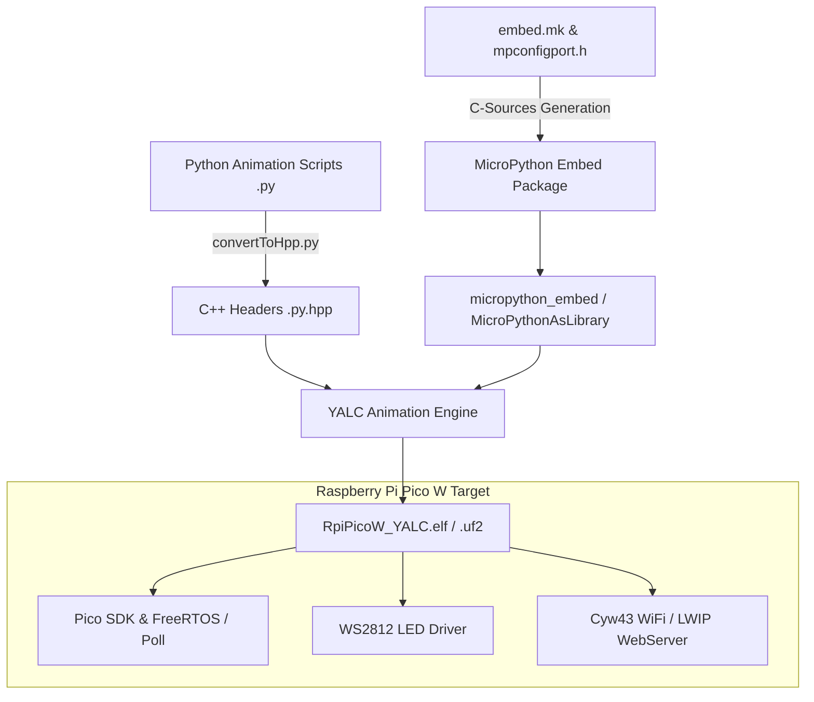

# YALC - Yet Another LED Controller (Raspberry Pi Pico W & Linux)

YALC is an advanced LED lighting control system (including WS2812 led strips), supporting animations written both in C++ and dynamically loaded **MicroPython** scripts embedded directly into the **Raspberry Pi Pico W** microcontroller and Linux environments.

---

## 🏛️ MicroPython Embedding Architecture

The project integrates a lightweight, embeddable version of the MicroPython environment directly within the microcontroller application structure.



### Key Architectural Components:
1. **Script Converter (`convertToHpp.py`)**: Automatically converts source `.py` files into static C++ character arrays (`.py.hpp`), allowing them to be interpreted by the embedded MicroPython engine in device Flash/RAM.
2. **MicroPython Embed**: An embeddable package dynamically generated using `embed.mk` macros and configured via `mpconfigport.h` (with enabled LED control modules, random number generation, and core runtime structures).
3. **LED Module (`modules/leds`)**: A custom User C Module integrating physical LED control directly from Python scripts executed on the Pico W.

---

## 📋 System and Toolchain Requirements

### For Linux (Ubuntu / Debian / Arch):
- **CMake** (version 3.16 or newer)
- **Make** or Ninja
- **Python 3.8+** (with pip)
- **ARM GNU Toolchain** (`arm-none-eabi-gcc`, `arm-none-eabi-g++`, `libnewlib-arm-none-eabi`) for embedded targets.
- **SFML** (optional, for running simulations under Linux).

---

## 🚀 Quick Start: Single-Command Build (`./build.sh`)

Clone the repository along with its submodules (including Pico SDK), then run the main build script:

```bash
# 1. Clone repository with all submodules
git clone --recursive https://github.com/your-repo/YALC.git
cd YALC

# 2. Run the build script (default target: raspberry_pico_w)
./build.sh
```

### Available `./build.sh` Options:
The script supports target selection via `-t` / `--target`:
- `raspberry_pico_w` (default) – builds firmware for Raspberry Pi Pico W and generates `build/RpiPicoW_YALC.uf2`.
- `linux` – builds the test application / simulator under Linux.

Example compilation for Linux:
```bash
./build.sh --target linux
```

---

## 🐳 Building inside a Docker Container

To ensure fully reproducible builds without requiring the ARM toolchain on your host machine, you can use the provided `Dockerfile`.

1. **Build the Docker image**:
   ```bash
   docker build -t yalc-builder .
   ```

2. **Run compilation inside the container**:
   ```bash
   docker run --rm -v $(pwd):/workspace yalc-builder ./build.sh
   ```

---

## 🤖 CI/CD Pipeline (GitHub Actions)

The project includes an automated GitHub Actions workflow (`.github/workflows/build.yml`) designed to build, verify, and package the firmware on every push and pull request.

### Workflow Highlights:
- **Docker-based Build Environment**: Builds using an isolated Ubuntu 22.04 container pre-configured with CMake, GCC ARM Toolchain, and submodules.
- **Git Safe Directory Handling**: Automatically sets up `git config --global --add safe.directory '*'` within the container to prevent Git ownership errors (`dubious ownership`) due to UID mismatch during GitHub Actions workspace volume mounting.
- **Strict Verification**: Fails the build pipeline immediately if the target `.uf2` firmware binary is not generated.
- **Artifact Archiving**: Automatically stores generated firmware (`.uf2` and `.elf`) as workflow artifacts for download (retained for 30 days).

You can inspect the workflow configuration in [.github/workflows/build.yml](file://.github/workflows/build.yml).

## 🛠️ Troubleshooting

1. **Missing ARM Compiler (`arm-none-eabi-gcc not found`)**:
   - *Solution*: Install cross-compilation packages on your system:
     ```bash
     sudo apt-get install gcc-arm-none-eabi libnewlib-arm-none-eabi
     ```
     Or use the provided Docker environment.

2. **Empty or Missing Pico SDK Submodule**:
   - *Solution*: Ensure the repository was cloned with the `--recursive` flag or update submodules manually:
     ```bash
     git submodule update --init --recursive
     ```

3. **MicroPython Library Linking Errors (`-lmicropython_embed: No such file or directory`)**:
   - *Solution*: This has been resolved in the latest version by adding a target alias (`add_library(micropython_embed ALIAS MicroPythonAsLibrary)`). Ensure you are using the latest CMakeLists.txt files in submodules.

---
*Documentation maintained by the YALC Architecture & QA Team.*
